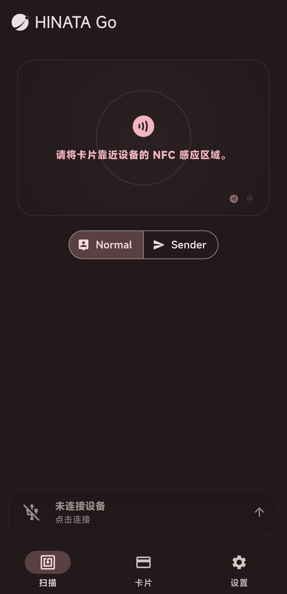
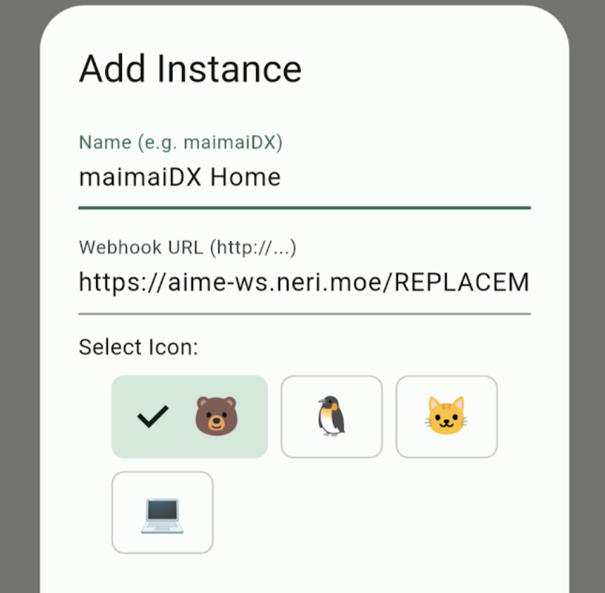

[English Guide](README_en.md) | **简体中文**

# HINATA Go

[](https://flutter.dev)
[](https://m3.material.io)
[](https://hinata.neri.moe/go/)

> [!NOTE]
> 本 README 部分内容由 AI 生成，如与实际功能存在偏差，请以[使用文档](https://hinata.neri.moe/go/)或应用内实际表现为准。

HINATA Go 是一款多平台 NFC 卡片工具与无线刷卡客户端，支持 **Android / iOS / Web（`go.neri.moe`）**。无需外接实体读卡器，可直接使用手机内置 NFC 配合 **HINATA IO** 与 **SpiceAPI**，为 **segatools**、**TAL** 及 **spicetools** 刷卡；同时也支持读取交通卡、管理本地卡包、写入 MIFARE 卡片、编辑 NDEF 标签，以及通过 Android USB-OTG 或桌面端浏览器 WebHID 管理外接 HINATA 读卡器（包括硬件卡模拟与固件 OTA 更新）。

## 下载与访问

<p align="left">
  <a href="https://apps.apple.com/app/id6760301105" target="_blank" rel="noopener noreferrer">
    
  </a>
  <a href="https://play.google.com/store/apps/details?id=moe.neri.hinatago&hl=zh" target="_blank" rel="noopener noreferrer">
    
  </a>
  <a href="https://github.com/Project-HINATA/hinata_go/releases/latest" target="_blank" rel="noopener noreferrer">
    
  </a>
  <a href="https://go.neri.moe" target="_blank" rel="noopener noreferrer">
    
  </a>
</p>

完整图文使用手册见 [HINATA 使用文档](https://hinata.neri.moe/go/)。

<p align="center">
  
</p>

---

## 与常见手机刷卡方案的差异

* **不需要局域网直连配置（HINATA IO）**：许多手机读卡器方案要求手机和电脑处于同一局域网并手动处理内网 IP、端口放行或防火墙设置。配合 **HINATA IO**（`segatools` / `TAL`）时，默认通过 WebSocket 中继通信（如公共节点 `aime-ws.neri.moe` 或自建服务端），只要设备联网即可跨网络发送卡号，无需折腾局域网连接；填写密码即可启用端到端加密。（`spicetools` 则仍使用局域网或自行转发的 SpiceAPI 地址。）
* **支持 M1 卡与旧式 Banapassport**：不止支持 FeliCa / Amusement IC，在 Android 与外接读卡器上同样支持 MIFARE Classic（M1）卡片，包括**旧式 M1 Aime** 与**旧式 M1 Banapassport**（注：受系统限制，iOS 不支持 M1 卡）。
* **读取真实 Access Code 而非仅取 IDm**：对于 Amusement IC、旧式 Aime 与旧式 Banapassport，会读取卡内记录的真实 20 位 Access Code，而不是仅读取 FeliCa IDm 转十进制作为卡号。
* **多平台与完整卡片工具链**：除手机端刷卡外，还提供 iOS、Web（`go.neri.moe`）、本地卡包分类与导入导出、MIFARE Classic 1K 写白卡、NDEF 编辑，以及外接 HINATA 读卡器的卡片模拟和固件 OTA 更新。

---

## 核心功能

### 1. 远程刷卡模式
配置并选择游戏实例后，在 **Sender 模式**下通过手机 NFC、已保存卡片或外接 HINATA 读卡器刷卡，卡号信息会自动发送至游戏：

* **segatools（HINATA IO / `hinata.dll`）**：通过 `aimeio` 接口转发卡片数据。
* **TAL（HINATA IO / `hinata.dll`）**：无需串口模拟，直接通过加载器插件接口读取或远程发送真实 Access Code。
* **spicetools（SpiceAPI）**：支持局域网 TCP 直连与 WebSocket 转发。
* **多实例与端到端加密**：支持管理多个游戏实例；HINATA IO 实例填写密码后自动启用端到端加密传输。

### 2. 卡片信息查看与卡包管理
读取并解析各类卡片信息（而非仅提取 UID/IDm），支持本地文件夹分类保存、刷卡历史追溯及数据导入导出：

* **街机游戏卡**
  * **Amusement IC（四社通）**：解析真实 20 位 Access Code、e-amusement 卡号、生产厂商及原始区块数据。
  * **旧式 Aime 或兼容卡（MIFARE Classic）**：读取真实 Access Code 与合法性状态。
  * **旧式 Banapassport 或兼容卡（MIFARE Classic）**：读取真实 Access Code。
  * **旧式 e-amusement pass / NESiCA**：读取 e-amusement 卡号 / NESiCA 卡片信息。
* **交通卡**
  * **日本交通系 IC（Suica / PASMO / ICOCA 等）**：查看余额与最近 20 条交易记录（内置日本铁路车站数据库解析乘降站名），重复扫描自动合并历史记录。
  * **交通联合（China T-Union）**：查看卡号、余额及最近 10 条交易记录。
* **其他卡片与标签**
  * **任意 FeliCa 卡片**：读取 IDm、PMm、System Codes 与全部未加密服务区块并支持一键复制原始数据。
  * **任意 ISO15693 卡片 & NDEF 标签**：读取卡片标识与 NDEF 负载。

### 3. 写卡、NDEF 编辑与卡片模拟
* **写入 MIFARE Classic 1K 游戏白卡**：支持将卡包内保存或手动添加的 20 位 Aime / Banapass 卡号写入 4 字节 UID 空白卡，提供「可再次写入」与「永久只读」两种权限模式（Android NFC 或桌面 Web / Android 外接 HINATA 读卡器可用）。
* **NDEF 编辑器与写入**：支持网址、文本、电话、邮件、短信、位置、Wi-Fi、联系人、Android 应用等记录类型，并支持写入时永久只读锁定。
* **读卡器模拟卡片**：连接外接 HINATA 读卡器（需新固件）后，可直接让读卡器模拟已保存的 **FeliCa / Amusement IC**、**MIFARE Classic 1K** 及 **NDEF 数据集**，供手机或其他读卡设备读取。
* **外接硬件管理**：通过 Android USB-OTG 或桌面浏览器 WebHID 连接 HINATA 读卡器，在应用内调整设置（LED 亮度、工作模式等）并在 `stable` / `canary` 通道间进行固件 OTA 更新。

---

## 平台功能支持对比

| 功能 | Android | iOS | Web (`go.neri.moe`) |
| :--- | :---: | :---: | :---: |
| 内置 NFC 读 FeliCa / Amusement IC / Suica / NESiCA / ISO15693 / NDEF | ✅ | ✅ | ❌ |
| 内置 NFC 读 **MIFARE Classic (M1)**（旧式 Aime / 旧式 Banapass 等） | ✅ | ❌ *(注 1)* | ❌ |
| 从卡包或手动添加卡号发送到游戏 | ✅ | ✅ | ✅ |
| 写入 MIFARE Classic 1K 游戏白卡 / 格式化 NDEF | ✅ | ❌ | 🔌 需接读卡器 |
| USB / WebHID 连接外接 HINATA 读卡器（含卡模拟与固件 OTA） | ✅ (USB-OTG) | ❌ *(注 2)* | ✅ (WebHID) |
| PRiSM Link 音游窝快速刷卡 / App Clip | ✅ | ✅ | ✅ |

> [!NOTE]
> **注 1（iOS 读卡限制）**：受限于苹果 CoreNFC 系统接口，**iPhone 无法读取 MIFARE Classic（M1 卡）**（包括旧式 Aime、旧式 Banapass 及 M1 兼容白卡）。iOS 端可正常读取 **Amusement IC（四社通）**、Suica 等 FeliCa 卡、NESiCA、ISO15693 及 NDEF；如需在 iPhone 上使用旧式 M1 卡号，可通过其他设备扫入后导入卡包，或在「卡片」页手动添加 20 位 Access Code 后使用。  
> **注 2**：iOS 平台无法通过 USB/WebHID 驱动外接 HINATA 读卡器，因此不支持读卡器模拟与固件 OTA。

---

## 读卡器模式快速配置

### 1. segatools（HINATA IO）
> 以下示例使用 HINATA 公共转发服务器 `aime-ws.neri.moe`（需网络可访问 Cloudflare）；支持任意自定义自建服务。

1. 在游戏端部署 [HINATA IO (`hinata.dll`)](https://hinata.neri.moe/game-setting/sega/hinata-client/)，并在 `segatools.ini` 中配置远程刷卡（或使用 HINATA Client 图形界面配置）：
   ```ini
   [aime]
   enable=1

   [aimeio]
   path=hinata.dll
   serverUrl=wss://aime-ws.neri.moe/REPLACEME
   ```
     
   *请将 `REPLACEME` 替换为自定义的唯一英文字符串，避免与他人撞车。*

2. 打开 HINATA Go，添加一个 Instance，URL 填写 `https://aime-ws.neri.moe/REPLACEME`（填写密码将启用端到端加密，游戏端需配置相同 `remotePassword`；留空则为明文兼容模式）。
   
3. 将 HINATA Go 切换为 **Sender 模式**并选中该实例，启动游戏后即可刷卡登录。

### 2. TAL（HINATA IO）
1. 下载 64 位 `hinata.dll` 放入 `\Executable\Release\plugins\hinata.dll`（详见[对应配置文档](https://hinata.neri.moe/game-setting/bandai-namco/)）。
2. 在 `config.toml` 的 `[emulation]` 下启用 `card_reader = true`。
3. 在游戏主程序同级目录创建 `hinata.ini`（**不要放在 `plugins` 目录内**）：
   ```ini
   [hinata]
   serverUrl=wss://aime-ws.neri.moe/REPLACEME
   ; 可选：开启端到端加密
   ; remotePassword=你的密码
   ```
4. 在 HINATA Go 中添加对应的 `https://aime-ws.neri.moe/REPLACEME` 实例并切换至 **Sender 模式**即可刷卡。

### 3. spicetools（SpiceAPI）
> 仅限局域网使用，或通过 Cloudflare Tunnel 等工具自行转发（支持 TCP 与 WebSocket）。

1. 打开 `spicecfg.exe`，配置 SpiceAPI 端口（可留空密码或配置对应密码）。
2. 在 HINATA Go 内添加 SpiceAPI 实例，URL 填写 `电脑局域网IP:Spice监听端口`（例如 `192.168.0.114:1145`，TCP 模式无需 `http://` 前缀）。
3. 切换至 **Sender 模式**并选中该实例后启动游戏。

---

## 常见问题（FAQ）

<details>
<summary><strong>1. 没有购买 HINATA 硬件读卡器，只用手机可以用吗？</strong></summary>

可以。使用支持 NFC 的手机（或发送卡包内已保存 / 手动添加的卡号），配合游戏端的 `hinata.dll`（HINATA IO）或 `SpiceAPI` 即可远程刷卡，不依赖实体 HINATA 读卡器。
</details>

<details>
<summary><strong>2. 为什么 iPhone 刷旧式 Aime / Banapass 卡没有反应？</strong></summary>

因为旧式 Aime 和旧式 Banapass 使用的是 **MIFARE Classic（M1）** 芯片，而苹果 iOS 系统未对第三方应用开放 M1 卡的读取权限，因此 iPhone 无法直接读取 M1 卡。**Amusement IC（四社通）**、Suica 等交通卡及 NESiCA 在 iPhone 上均可正常读取。
</details>

<details>
<summary><strong>3. HINATA Go 读出的 Access Code 和其他仅读 IDm 转换的工具一样吗？</strong></summary>

不一样。部分同类工具仅读取 FeliCa 的 IDm 并直接转成十进制补零作为卡号；HINATA Go 会直接读取 **Amusement IC、旧式 Aime、旧式 Banapassport** 卡内存储的真实 20 位 Access Code，卡号与官方读卡器一致。
</details>

<details>
<summary><strong>4. 使用读卡器模拟卡片可以用于官方服务器吗？</strong></summary>

不能。模拟功能仅还原扫描时保存的公开数据，无法代替真卡通过官方机台的卡片校验，因此不能用于官方联网服务器，主要用于私服、NDEF 标签模拟以及测试验证。详细说明见[模拟卡片文档](https://hinata.neri.moe/go/features/emulate-card)。
</details>

---

## 交流与文档
- 使用文档：<https://hinata.neri.moe/go/>
- 网页端入口：<https://go.neri.moe>
- 交流群：[QQ 1085979135](https://qun.qq.com/universal-share/share?ac=1&authKey=YzIhakJWJ7BmvG%2F1JJLr27LFwpC050aWFeatFIjOhQM0i5RgEOVVZHuDop7nvlV%2F&busi_data=eyJncm91cENvZGUiOiIxMDg1OTc5MTM1IiwidG9rZW4iOiJHOHEwYmlqYWNyakJaeDlGQ1B2Mm5TUUNCUTZESUo2cGtpWUZwZEkrSVAyOTJwUmNsWWFnckd5NmdvMDJhMWtGIiwidWluIjoiMTAxNTkyOTQ1MiJ9&data=Dp-q7I-pDdniotBs8a4b6u7WM2CuxwRxphBKcVkxtF_IB8A1xp4oKNytX9NglpUJcpD0wc2hjgP4dIF4-7xpkw&svctype=4&tempid=h5_group_info)
