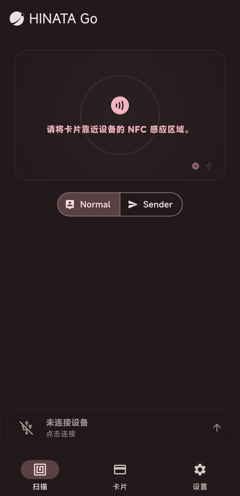
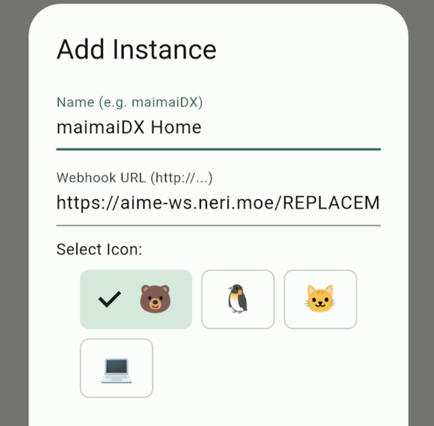

**English** | [简体中文](README.md)

# HINATA Go

[](https://flutter.dev)
[](https://m3.material.io)
[](https://hinata.neri.moe/en/go/)

> [!NOTE]
> Parts of this README were generated with AI assistance. If anything differs from actual behavior, please refer to the [documentation](https://hinata.neri.moe/en/go/) or the app itself.

HINATA Go is a cross-platform NFC card tool and wireless card reader client for **Android, iOS, and Web (`go.neri.moe`)**. It works standalone with a phone's built-in NFC—without an external hardware reader—to send cards to **segatools**, **TAL**, and **spicetools** via **HINATA IO** and **SpiceAPI**. It also supports transit card inspection, a local card wallet, MIFARE Classic 1K writing, NDEF editing, and external HINATA reader management (including card emulation and OTA firmware updates via Android USB-OTG or desktop WebHID).

## Downloads & Access

<p align="left">
  <a href="https://apps.apple.com/app/id6760301105" target="_blank" rel="noopener noreferrer">
    
  </a>
  <a href="https://play.google.com/store/apps/details?id=moe.neri.hinatago&hl=en" target="_blank" rel="noopener noreferrer">
    
  </a>
  <a href="https://github.com/Project-HINATA/hinata_go/releases/latest" target="_blank" rel="noopener noreferrer">
    
  </a>
  <a href="https://go.neri.moe" target="_blank" rel="noopener noreferrer">
    
  </a>
</p>

Full illustrated user guide: [HINATA Documentation](https://hinata.neri.moe/en/go/).

<p align="center">
  
</p>

---

## How It Differs from Other Solutions

* **No LAN / Local IP Hassle (HINATA IO)**: Many phone-based reader tools require the phone and PC to be on the same LAN and need manual IP, firewall, or port setup. With **HINATA IO** (`segatools` / `TAL`), communication runs over a WebSocket relay (such as `aime-ws.neri.moe` or a self-hosted server), so cards can be sent across networks without configuring LAN routing, with optional end-to-end encryption. (`spicetools` still uses a LAN or self-forwarded SpiceAPI endpoint.)
* **MIFARE Classic (M1) & Legacy Banapassport Support**: Beyond FeliCa and Amusement IC, Android and external HINATA readers support M1 cards, including **legacy M1 Aime** and **legacy M1 Banapassport** (due to iOS system limits, iOS does not support M1).
* **Real Access Code Instead of IDm Fallback**: Reads the actual 20-digit Access Code stored on Amusement IC, legacy Aime, and legacy Banapassport cards rather than converting a FeliCa IDm into a decimal fallback.
* **Cross-Platform & Full Card Toolkit**: Includes iOS and Web (`go.neri.moe`) clients, multi-instance management, local card wallet import/export, MIFARE Classic 1K card writing, NDEF editing, and hardware card emulation plus OTA updates when paired with an external HINATA reader.

---

## Core Features

### 1. Remote Card Reader Mode
Select an active game instance and switch to **Sender Mode** to automatically forward swiped cards via built-in NFC, saved wallet cards, or an external HINATA reader:

* **segatools (HINATA IO / `hinata.dll`)**: Forwards card data through the `aimeio` interface.
* **TAL (HINATA IO / `hinata.dll`)**: Reads and forwards real Access Codes directly through the loader plugin interface without COM port emulation.
* **spicetools (SpiceAPI)**: Supports both LAN TCP and WebSocket connections.
* **Multi-Instance & Encryption**: Manage multiple instances; setting a password on a HINATA IO instance enables end-to-end encryption.

### 2. Card Information Viewer & Card Wallet
Reads detailed card information rather than just UID/IDm, with folder organization, scan history, and import/export:

* **Arcade / Amusement Cards**
  * **Amusement IC**: Real 20-digit Access Code, e-amusement card number, card manufacturer, and raw FeliCa blocks.
  * **Legacy Aime & Compatible Cards (MIFARE Classic)**: Real Access Code and legitimacy status.
  * **Legacy Banapassport & Compatible Cards (MIFARE Classic)**: Real Access Code.
  * **Legacy e-amusement pass / NESiCA**: e-amusement card number / NESiCA details.
* **Transit Cards**
  * **Japanese Transit IC (Suica, PASMO, ICOCA, etc.)**: Balance and up to 20 recent transactions with station names resolved from a built-in railway database; re-scanning merges new history automatically.
  * **China T-Union**: Card number, balance, and up to 10 recent transactions.
* **Other Cards & Tags**
  * **Any FeliCa Card**: IDm, PMm, System Codes, and all unencrypted blocks across all systems (with raw block copy/export).
  * **Any ISO15693 Card & NDEF Tags**: Card identifiers and NDEF records.

### 3. Card Writing, NDEF Editor & Card Emulation
* **Write MIFARE Classic 1K Game Cards**: Write saved or manually added 20-digit Aime / Banapassport Access Codes onto 4-byte UID blank cards with **Rewritable** or **Permanently Read-Only** access modes (via Android NFC or a connected HINATA reader).
* **NDEF Editor & Writer**: Create and write URL, text, phone, email, SMS, location, Wi-Fi, contact, and Android app records with optional permanent read-only lock.
* **Hardware Card Emulation**: With a connected HINATA reader (updated firmware required), emulate saved **FeliCa / Amusement IC**, **MIFARE Classic 1K**, and **NDEF datasets** for phones or other readers.
* **External Reader Management**: Configure hardware settings (LED brightness, mode restrictions, etc.) and run OTA firmware updates across `stable` / `canary` channels via Android USB-OTG or desktop WebHID.

---

## Platform Compatibility

| Capability | Android | iOS | Web (`go.neri.moe`) |
| :--- | :---: | :---: | :---: |
| Built-in NFC: FeliCa / Amusement IC / Suica / NESiCA / ISO15693 / NDEF | ✅ | ✅ | ❌ |
| Built-in NFC: **MIFARE Classic (M1)** (Legacy Aime / Legacy Banapass) | ✅ | ❌ *(Note 1)* | ❌ |
| Send saved or manually entered Access Codes to games | ✅ | ✅ | ✅ |
| Write MIFARE Classic 1K Aime/Banapass cards / Format NDEF | ✅ | ❌ | 🔌 Reader required |
| Connect external HINATA reader (Card Emulation & Firmware OTA) | ✅ (USB-OTG) | ❌ *(Note 2)* | ✅ (WebHID) |
| PRiSM Link arcade venue tap / App Clip | ✅ | ✅ | ✅ |

> [!NOTE]
> **Note 1 (iOS NFC Limitation)**: Due to Apple CoreNFC system restrictions, **iPhones cannot read MIFARE Classic (M1) cards** (such as legacy Aime, legacy Banapassport, or M1-based compatible cards). **Amusement IC** (FeliCa), Suica/PASMO, NESiCA, ISO15693, and NDEF tags work normally on iOS. To use legacy M1 card numbers on iOS, scan them on Android/Web and import them, or manually add the 20-digit Access Code in the Cards tab.  
> **Note 2**: iOS cannot drive external HINATA readers over USB/WebHID, so hardware card emulation and firmware OTA require Android or the desktop Web app.

---

## Quick Connection Guide

### 1. segatools (HINATA IO)
> The example below uses the HINATA public relay `aime-ws.neri.moe` (requires Cloudflare reachability); self-hosted servers are also supported.

1. Deploy [HINATA IO (`hinata.dll`)](https://hinata.neri.moe/en/game-setting/sega/hinata-client/) and configure `segatools.ini` (or use HINATA Client):
   ```ini
   [aime]
   enable=1

   [aimeio]
   path=hinata.dll
   serverUrl=wss://aime-ws.neri.moe/REPLACEME
   ```
     
   *Replace `REPLACEME` with a unique custom string.*

2. In HINATA Go, add an Instance with URL `https://aime-ws.neri.moe/REPLACEME` (set a password to enable end-to-end encryption, matching `remotePassword` on the game side; leave blank for legacy plaintext).
   
3. Switch HINATA Go to **Sender Mode**, select the instance, and launch the game.

### 2. TAL (HINATA IO)
1. Place the 64-bit `hinata.dll` into `\Executable\Release\plugins\hinata.dll` (see the [setup guide](https://hinata.neri.moe/en/game-setting/bandai-namco/)).
2. Enable `card_reader = true` under `[emulation]` in `config.toml`.
3. Create `hinata.ini` next to the game executable (**not** inside `plugins`):
   ```ini
   [hinata]
   serverUrl=wss://aime-ws.neri.moe/REPLACEME
   ; Optional end-to-end encryption
   ; remotePassword=your_password
   ```
4. Add `https://aime-ws.neri.moe/REPLACEME` in HINATA Go and switch to **Sender Mode**.

### 3. spicetools (SpiceAPI)
> LAN only unless forwarded via Cloudflare Tunnel or similar (supports TCP and WebSocket).

1. Open `spicecfg.exe` and configure the SpiceAPI port.
2. Add a SpiceAPI Instance in HINATA Go with URL `your_pc_lan_ip:spice_port` (e.g. `192.168.0.114:1145`, without `http://` for TCP).
3. Switch to **Sender Mode**, select the instance, and start the game.

---

## FAQ

<details>
<summary><strong>1. Can I use HINATA Go without buying a physical HINATA reader?</strong></summary>

Yes. A phone with NFC (or saved/manually entered cards in the wallet) works directly with `hinata.dll` (HINATA IO) or `SpiceAPI`, without requiring an external HINATA reader.
</details>

<details>
<summary><strong>2. Why doesn't my iPhone respond when scanning a legacy Aime or Banapassport card?</strong></summary>

Legacy Aime and Banapassport cards use **MIFARE Classic (M1)** chips. iOS does not expose M1 card reading permissions to third-party apps, so iPhones cannot read M1 cards directly. **Amusement IC** (FeliCa), Suica/PASMO, NESiCA, ISO15693, and NDEF tags can all be read directly on iPhone.
</details>

<details>
<summary><strong>3. Does HINATA Go convert FeliCa IDm into an Access Code, or read the real one?</strong></summary>

It reads the real 20-digit Access Code stored inside **Amusement IC, legacy Aime, and legacy Banapassport** cards, matching real arcade readers rather than deriving a decimal fallback from FeliCa IDm.
</details>

<details>
<summary><strong>4. Can emulated cards be used on official arcade networks?</strong></summary>

No. Emulation only replays the public data captured during scanning and cannot pass official cabinet verification, so official online servers will reject emulated cards. It is intended for private servers, NDEF tag emulation, and testing. See the [Card Emulation guide](https://hinata.neri.moe/en/go/features/emulate-card) for details.
</details>

---

## Links & Community
- Documentation: <https://hinata.neri.moe/en/go/>
- Web App: <https://go.neri.moe>
- Community Group: [QQ 1085979135](https://qun.qq.com/universal-share/share?ac=1&authKey=YzIhakJWJ7BmvG%2F1JJLr27LFwpC050aWFeatFIjOhQM0i5RgEOVVZHuDop7nvlV%2F&busi_data=eyJncm91cENvZGUiOiIxMDg1OTc5MTM1IiwidG9rZW4iOiJHOHEwYmlqYWNyakJaeDlGQ1B2Mm5TUUNCUTZESUo2cGtpWUZwZEkrSVAyOTJwUmNsWWFnckd5NmdvMDJhMWtGIiwidWluIjoiMTAxNTkyOTQ1MiJ9&data=Dp-q7I-pDdniotBs8a4b6u7WM2CuxwRxphBKcVkxtF_IB8A1xp4oKNytX9NglpUJcpD0wc2hjgP4dIF4-7xpkw&svctype=4&tempid=h5_group_info)
